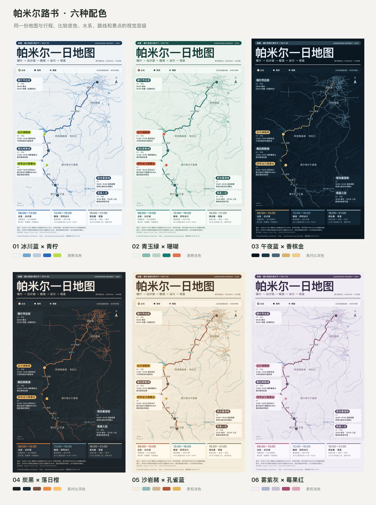

# 地图攻略可视化 · Travel Map Visualizer

将文字版旅行攻略、景点清单或按天行程转成基于真实地理数据的地图海报，交付可离线打开的 HTML 和高清 PNG。

## 六种配色

首次使用时先展示下方对比图，选择 01–06、自定义配色或让助手推荐。已经指定风格、或继续修改同一张地图时，直接采用已有选择。



## 功能

- 从文字行程提取地点、顺序、时间及注意事项。
- 根据用户区域下载公开地图数据，不内置地区地图数据或底图瓦片。
- 使用真实道路几何绘制路线，显示国道、水系、沿途县级地名等路书信息。
- 六套配色统一应用于地图、路线、景点标记和信息卡。
- 输出 HTML、PNG，以及可修改的 SVG、行程 JSON 和数据来源记录。

## 安装与使用

将本仓库克隆到 Codex 的 skills 目录；如果已经安装，请先备份并更新已有目录：

```sh
git clone https://github.com/dengxinligo-max/travel-map-visualizer.git ~/.codex/skills/travel-map-visualizer
```

在支持本地 skills 的 Codex 会话中使用：

```text
使用 $travel-map-visualizer，根据以下行程生成地图攻略，输出 HTML 和 PNG：
[粘贴行程]
```

也可以明确指定：

```text
使用 $travel-map-visualizer，选择 03 午夜蓝 × 香槟金，生成我的旅行路书。
```

完整工作流见 [SKILL.md](SKILL.md)。

## 环境与工具

地图下载、道路路径计算、基础渲染和配色脚本使用 Python 3 标准库。PNG 导出使用 Node.js，以及 Playwright/Chromium 或 Sharp；中文地图需要可用的中文字体。下载地图需要网络，离线成品在数据和字体嵌入后可独立打开。

- [行程数据结构](references/schema.md)
- [公开地图数据来源](references/map-sources.md)
- [风格选择与应用](references/styles.md)
- [HTML 与 PNG 导出](references/export.md)

## 数据与使用边界

示例图仅供比较配色，不代表最新出行建议。每次正式生成时，应按目的地区域获取地图数据，并核实景点与入口位置。

附带的本地路由工具沿下载的道路中心线计算路径，不完整支持转向限制、实时封路与交通；结果不能代替实时导航。景点到道路的未核实接驳段需明确标注。

地图数据的署名和使用许可独立于项目代码。使用 OpenStreetMap 等来源时保留相应署名、许可及下载记录；示例图保留原有来源说明。项目未附带开放源代码许可证，不应将仓库公开等同于授予任意再许可权利。
